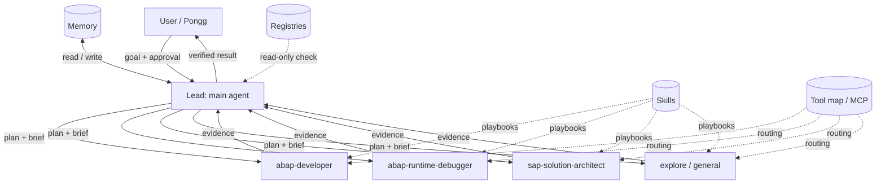
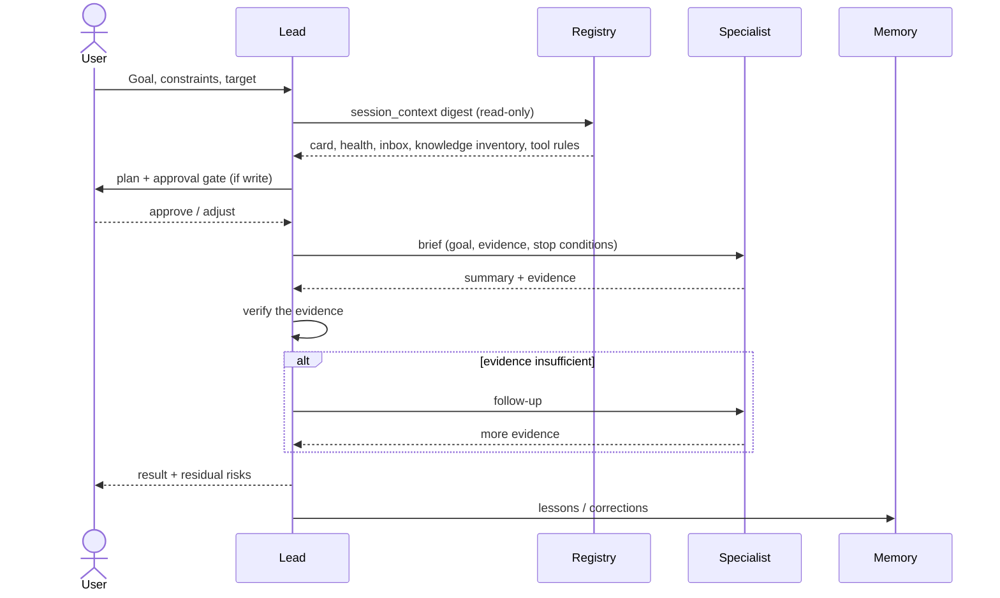

# ABAP Agent Workspace (OpenCode)

A portable workspace where the human and the AI grow together.

This repository is the backup and the operating manual for a small AI teammate:

- a **user profile** that teaches the AI how you work
- durable **lessons** and **corrections**
- **agent / skill / MCP registries**
- **project resume cards**
- a **read-only scanner** that reports drift

It is harness-aware but not harness-locked: this repository is the **OpenCode**
side. Copilot keeps its own separate setup, so the two can be compared.

**Status:** v0.5 — the knowledge-base memory model (incident → inbox → consolidation
gate → knowledge entry), tiered context loading, memory and registries, the registry
scanner, and the live tool snapshot plugin.
Last scan: 2026-11-14 · **issues: 0 · warnings: 5** (review items, none broken).

## Workspace layout

The portfolio root is `<portfolio>`; the SAP workspace is
`SAP Projects`:

```
<portfolio>\
├── INDEX.md                        # small, shared read-only
├── AGENTS.md                       # portfolio rules
└── SAP Projects\
    ├── AGENTS.md                   # SAP workspace rules
    ├── abap-agent-workspace-opencode\   # this repository
    └── Projects\
        └── DEMO\
            ├── AGENTS.md
            ├── project.yaml
            ├── _archive\           # this project's archive
            ├── _sandbox\           # this project's experiments
            └── ZDEMO01\
                ├── AGENTS.md
                ├── program.yaml
                └── ...             # SAP program work
```

New global folders go under the portfolio or workspace root as appropriate. New
SAP projects go under `Projects\<PROJECT>\<PROGRAM>\`, with an uppercase project
code and the SAP object name. Every project and program folder has
`README.md`, `AGENTS.md`, and a small manifest. Each project owns its own
`_archive`/`_sandbox`.

Every program also carries `spec.md` - the contract we build and test against
(requirements, acceptance criteria, approved deviations, open questions) - and
`spec\source\`, which holds the customer FS as received and is never edited. The
spec is written at the program level, because that is where a requirement is
signed off; the project keeps only `README.md` + `project.yaml` unless the project
itself is the deliverable. Template: `templates/spec.md`. Check:
`scripts\closeout.py`.

`Projects\` is not a git repository, so the specs are mirrored into this one:

```
specs\<PROJECT>\<PROGRAM>\spec.md
specs\<PROJECT>\<PROGRAM>\CHANGELOG.md
specs\manifest.json            # version, status, sha256 per file
```

The customer FS is **not** mirrored - it is the customer's document, and this
repository must not carry customer data. The mirror is generated: edit the program
copy, then `python scripts\specs_sync.py --write`; `closeout.py` warns when it is
stale. Read the program copy, not the mirror.

**Access rule:** read/write inside the current project is allowed; read/write
outside it requires explicit user permission. Never recursively scan
`SAP Projects` or `<portfolio>`; use `INDEX.md` and the manifests.

## Team model

The main agent is the team lead. Specialists are subagents. The lead owns the
final answer and writes memory; specialists return evidence, not conclusions.



**Legend**

| Edge | Meaning |
|---|---|
| solid | work / handoff |
| dashed | reference / lookup |
| double | memory read/write (lead only) |

## Task lifecycle



The lead never forwards a subagent claim as a fact. Evidence is checked first.

## Approval gates

| Action | Gate |
|---|---|
| Read-only inspection | proceed |
| SAP write, activate, or transport | explicit approval with target + transport |
| Edit a personal `*-by-pongg` file | propose, then wait for approval |
| Edit a vendor agent or skill | never; wrap or fork into a personal file |
| Enable or disable an MCP server | propose, then wait for approval |

## Operating principles

1. **Evidence over guesses.** Unknown means "unknown" plus a read-only check.
2. **One owner per artifact.** Never parallel-write the same file or object.
3. **Read before write.** Re-read the live source; the local copy may be stale.
4. **Verify before claim.** Saved is not activated; activated is not tested.
5. **Ask before irreversible.** SAP writes, transports, and deletions.
6. **Vendor files are read-only.** Personal work lives in `*-by-pongg` files.
7. **Keep Copilot and OpenCode separate.** Different memory, different registries.

## Layout

```
README.md
AGENTS.md                 # workspace rules for any agent opened here
SECURITY.md
.gitattributes
CHANGELOG.md
memory/
  README.md               # how the memory system works (the consolidation gate)
  user-profile.md         # how the user communicates and decides
  corrections.md          # INBOX: incidents not yet consolidated (≤7 days)
  expertise.md            # the end state: reflex / enforced / handbook + cold probes
  knowledge/              # durable memory: one entry per rule, by domain
    README.md             # schema, caps, how an entry changes
    working-method.md     # how to do the work
    tooling.md            # which tool owns which job
    sap-gui.md            # driving the SAP GUI
    sap-abap.md           # ABAP and API contracts
    sap-data.md           # which table is the truth
  skill-candidates.md     # patterns that may become skills
  agent-registry.md       # who owns which agent (editable vs vendor)
  tool-map.md             # task -> authoritative tool -> fallback
  team-roster.md          # subagent roles and delegation rules
  projects/
    README.md             # project-card template
    DEMO/
      zmme011.md          # project resume card
  _archive/
    v0-ledger/            # the 2026-11 ledger model (lessons.md + corrections.md)
  reports/
    registry-report.md    # generated by the scanner
registries/
  README.md
  agents.json             # agent inventory
  skills.json             # skill inventory
  mcp-servers.json        # configured MCP servers
  tools.json              # tool-catalog baseline (ids + namespaces)
  tools-snapshot.json     # latest captured snapshot
  tools-full.json         # latest full tool list (id, name, namespace)
plugins/
  tool-snapshot/          # OpenCode server plugin; writes the tool snapshot
scripts/
  README.md
  session_context.py      # one-call session digest (tiered context)
  closeout.py             # end-of-task check: inbox, card, plan, knowledge dates
  registry_check.py       # read-only scanner
  memory_check.py         # read-only memory integrity check
templates/
  AGENTS.md               # pointer block for a new machine
  plan.md                 # plan + todo template for a long task
  probes.md               # the 9 cold probes as paste-ready prompts
docs/
  design.md               # why the teammate works this way
  lifecycle.md            # onboarding / offboarding agents, skills, MCP
  comparison.md           # Copilot vs OpenCode scorecard
```

## Current registry snapshot

| Area | Count | Notes |
|---|---|---|
| Skills | 134 entries | opencode 31, agents 47, claude 30, copilot 26; 47 vendor skills parked outside the catalog |
| Agents | 24 | 4 editable (`*-by-pongg`), 20 vendor |
| MCP servers | 14 | 8 enabled, 6 disabled; SAP, GUI, docs, Playwright are on-demand, `rosa` removed |
| Tools | 111 | 5 namespaces; measured 211 before the 2026-11-14 diet |

Prompt cost measured 2026-11-14: **36.0k chars per session** (skills 19.8k + tools
16.1k), down from 73.3k — both catalogs inside budget. See `docs/design.md`
§"Prompt budget". Parked skills and how to restore them:
`~\.config\opencode\skills-parked\RESTORE.md`.

The `sap-ai-dev-toolkit` 0.9.9924 update added 6 Copilot skills and 5 Copilot
agents (BTP, BW/DataSphere, Cloud ALM, DataSphere, process automation, DevOps
observability). They are vendor-owned and live in the Copilot registry only.

**Known warnings (not actionable):** 4 vendor skill descriptions exceed 1,000
characters — `abap-cloud-migration`, `badi-enhancement`,
`sap-integration-wiki`, `sap-support-case`. They are vendor-owned; forking is the
only way to shorten them. One newly installed skill and the idle `ds4-100` server
are reported as warnings by design, not as issues.

`ds4-100` is an on-demand SAP server: it is enabled only during SAP work, and
`ds4-900` stays disabled. Both namespaces are marked optional in the tool
baseline, so turning them on or off does not create false drift.

## Quick start on a new machine

1. Clone this repository.
2. Copy `memory/` to `~/.config/opencode/memory/` (or point the global
   `AGENTS.md` at this repository).
3. Add the pointer block from `templates/AGENTS.md` to the global `AGENTS.md`.
4. Run `python scripts/registry_check.py --init` once, then `--check`.

## Quick use

Requires Python 3.8+; the scripts use only the standard library.

```bash
# one call at session start: project card + health + open inbox + knowledge inventory
python scripts/session_context.py
python scripts/session_context.py --tiny    # light tier: ~0.8k chars

# then pick a tier: light (digest only) / task (+ card + the card's domains) / deep

python scripts/closeout.py                         # end of task: 4 rot checks
python scripts/registry_check.py --check           # full registry report + prompt budget
python scripts/registry_check.py --refresh         # merge new items
python scripts/memory_check.py                     # memory integrity, after close-out
```

`registry_check.py` also measures the **prompt budget**: the skill catalog and the
tool descriptions that the harness injects into every session, against the budgets
in `docs/design.md`.

Exit code `0` means nothing is broken; `1` means the report has an issue. Warnings
(new asset, stale date, over-budget description, idle on-demand SAP server) do not
fail the check — they need a human decision, not a fix.

The report is written to `memory/reports/registry-report.md`.

The tool snapshot is written automatically by `plugins/tool-snapshot` when
OpenCode loads and when the tool catalog changes. There is no manual snapshot
step; commit the updated `registries/tools-snapshot.json` and
`registries/tools-full.json` when they change.

## Compare Copilot vs OpenCode

The two harnesses stay separate: no shared memory, no shared registries. Run the
same task on both and record the scorecard in `docs/comparison.md`:

- correctness
- evidence (syntax / runtime)
- tool calls and turns
- safety (pre-flight, approval)
- context/token cost
- time to result

## Roadmap

- [x] Bootstrap memory snapshot and project card
- [x] `scripts/registry_check.py` — skills / MCP / tools drift report
- [x] `registries/*.json` — machine-readable snapshot
- [x] Session-start registry brief (global `AGENTS.md`)
- [x] Tool snapshot automation (OpenCode plugin `ctx.tool.list()`)
- [x] Tool-level drift (new/missing tool IDs)
- [x] Tiered context loading: `scripts/session_context.py` + `light/task/deep`
- [x] Issue vs warning split so a healthy session exits 0
- [ ] Skill and MCP onboarding gates
- [ ] Compare OpenCode vs Copilot on the same task

## Privacy and license

Private repository. No credentials, tokens, or customer data. See `SECURITY.md`.

License: private, all rights reserved.
