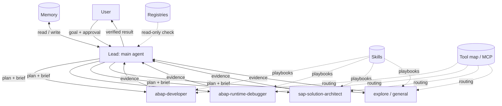

# ABAP AI OpenCode Toolkit

A small, portable AI teammate for ABAP work: a memory system that compounds, a
per-program contract, a registry scanner, and the wiring that puts them inside your
OpenCode session.

The repository has **two layers**, and keeping them apart is the whole design:

| Layer | What it is | Where it lives |
|---|---|---|
| **Toolkit** | scripts, templates, docs, the tool-snapshot plugin, the SAP launcher | this repository, git-tracked |
| **Instance** | your memory cards, knowledge entries, specs mirror, registry report | `workspace/`, never committed here |

Clone the toolkit, run `install.ps1`, and the instance is yours. A colleague can do
the same without inheriting your notes.

## Why

- **Memory that grows by editing, not by logging.** An incident lands in an inbox,
  gets consolidated at close-out into a knowledge entry, and a rule that repeats is
  promoted to `AGENTS.md` or a check. The same file is edited, never appended.
- **A contract per program.** `spec.md` holds requirements, acceptance criteria,
  approved deviations and open questions; `CHANGELOG.md` holds one row per deploy,
  covering the window SAP's version management does not.
- **Cheap session starts.** One command prints the resume card, the health of memory
  and registries, the open inbox, and the tool rules — then you read only what the
  task needs.

## Requirements

- Windows 10/11, PowerShell 5.1+
- Python 3.8+ (the scripts use only the standard library)
- [OpenCode](https://opencode.ai)
- Optional: an SAP ADT MCP server (`ai-dev`, `arc1`) and the SAP GUI for the launcher

## Install

```powershell
git clone https://github.com/naruepan2/abap-ai-opencode-toolkit.git
cd abap-ai-opencode-toolkit
.\install.ps1 -DryRun      # show every action
.\install.ps1 -Seed        # do it
```

Restart OpenCode once, then:

```powershell
python scripts\session_context.py
```

`install.ps1` is idempotent and does five things:

| Step | Effect |
|---|---|
| instance | creates `workspace\memory` and `workspace\specs`, seeds them from `templates\instance` |
| junction | points `~\.config\opencode\memory` at the instance |
| plugin | registers `plugins\tool-snapshot` in `~\.config\opencode\opencode.json` |
| pointer | adds a marked block to `~\.config\opencode\AGENTS.md` |
| registry | runs `registry_check.py --init` to baseline this machine |

It never touches SAP profiles, credentials, or MCP entries. Every file it rewrites
gets a timestamped `.bak` next to it. Use `-SkipAgents` if your global `AGENTS.md`
already has a memory block, `-SkipRegistry` to leave the registries alone.

## Layout

```
abap-ai-opencode-toolkit\          # this repository
├── install.ps1                    # one command: instance, junction, plugin, AGENTS
├── scripts\                       # digest, closeout, registry and memory checks
├── templates\                     # spec, changelog, plan, probes, instance seed
├── plugins\tool-snapshot\         # OpenCode plugin that captures the tool catalog
├── config\opencode-sap\           # SAP launcher + Windows keychain helper
├── registries\                    # machine snapshots, regenerated per machine
└── workspace\                     # YOUR instance - git-ignored
    ├── memory\                    #   cards, knowledge, inbox, tool map
    └── specs\                     #   mirror of Projects\**\spec.md
```

`workspace\` is what `~\.config\opencode\memory` points at. To keep the instance in
its own private repository, clone it elsewhere and set `ABAP_WORKSPACE` to that
path; the toolkit never needs to know.

The scripts assume a portfolio that keeps SAP work in `Projects\<PROJECT>\<PROGRAM>\`
with an `INDEX.md` above it. Neither is required: `ABAP_PROJECTS_ROOT` and
`ABAP_INDEX` point the checks at any tree.

## Daily use

```bash
# session start: card, health, inbox, knowledge inventory, tool rules
python scripts/session_context.py
python scripts/session_context.py --tiny     # light tier, ~0.8k chars

# end of task: inbox, card, plan, knowledge dates
python scripts/closeout.py
python scripts/closeout.py --project DEMO/ZDEMO01

# registries and the prompt budget
python scripts/registry_check.py --check
python scripts/registry_check.py --check --brief
python scripts/registry_check.py --refresh   # only after installing a skill, agent or MCP server

python scripts/memory_check.py               # integrity of the memory system
python scripts/specs_sync.py --write          # mirror program specs into the instance
```

Exit code `0` means nothing is broken; `1` means the report has an issue. Warnings
(new asset, stale date, over-budget description, idle on-demand server) need a human
decision, not a fix. The full report lands in
`workspace/memory/reports/registry-report.md`.

## Memory model

| Tier | When | Read |
|---|---|---|
| `light` | a question, an analysis, a review | the digest only |
| `task` | code, file, or SAP work | digest + the project card + its knowledge domains |
| `deep` | new project, incident, design | digest + every memory file |

An incident is captured in `workspace/memory/corrections.md` the moment it happens
(one row, ≤240 characters, status `open`). At close-out each row gets exactly one
outcome: merged into `workspace/memory/knowledge/<domain>.md` (Seen +1), added as a
new entry, promoted to `AGENTS.md` or a skill, or dropped as a one-off. The row is
then marked `drained`. The history is git, not a second log.

## The spec contract

Every program folder carries `spec.md` — requirements, acceptance criteria,
approved deviations, open questions — and `CHANGELOG.md`, one table row per deploy
(`Ver | Date | What changed | Verified`). The customer FS lives in `spec/source/`,
is immutable, and is never committed. The spec is written at the program level
because that is where a requirement is signed off.

`scripts/closeout.py` checks the front matter, the FS file and the REQ/AC tables, and
warns when the newest changelog row is behind `implemented_version`.

## SAP MCP (optional)

`config/opencode-sap/` holds a launcher that turns one profile into either engine:

| File | Purpose |
|---|---|
| `sap-mcp.ps1` | `-Profile <name> -Engine ai-dev\|arc1`, `-AllowWrites`, `-DryRun`, `-PromptTest` |
| `sap-cred.ps1` | Credential Manager (`CredRead`/`CredWrite`) plus the native sign-in dialog |
| `store-sap-secret.ps1` | store / list / remove a password for a profile |
| `profiles.example.json` | the shape of a profile: URL, client, user, system, CA, package allowlist |

The password is resolved in this order: `SAP_PASSWORD` in the process environment →
Windows Credential Manager (`sap-mcp:<profile>`) → the native Windows sign-in
dialog, which stores what you type so the next start is silent. Nothing is written
to a JSON file. A 401 means the password is wrong: re-store it, never retry it.

The launcher prints one line to stderr on every start naming the password source.
Trust that line before blaming SAP — a stale `SAP_PASSWORD` inherited by a running
app overrides the keychain.

Give the MCP startup time when a dialog can appear: `mcp.timeout.startup` in
`opencode.json` (180000 ms here; the default is 30 s).

## Team model

The main agent is the team lead. Specialists are subagents. The lead owns the final
answer and writes memory; specialists return evidence, not conclusions.



## Principles

| Action | Gate |
|---|---|
| Read-only inspection | proceed |
| SAP write, activate, or transport | explicit approval with target + transport |
| Edit a personal `*-by-pongg` file | propose, then wait for approval |
| Edit a vendor agent or skill | never; wrap or fork into a personal file |
| Enable or disable an MCP server | propose, then wait for approval |

1. **Evidence over guesses.** Unknown means "unknown" plus a read-only check.
2. **One owner per artifact.** Never parallel-write the same file or object.
3. **Read before write.** Re-read the live source; the local copy may be stale.
4. **Verify before claim.** Saved is not activated; activated is not tested.
5. **Ask before irreversible.** SAP writes, transports, and deletions.
6. **Vendor files are read-only.** Personal work lives in `*-by-pongg` files.

## Working with other people

- Each person runs `install.ps1` in their own clone and gets an empty instance.
- `workspace/` never leaves your machine through this repository. Keep it in its own
  private repository (and set `ABAP_WORKSPACE`) if you want it backed up.
- `registries/*.json` describe **one machine**. A colleague's `--refresh` will
  conflict with yours; take your side and refresh again.
- The toolkit is MIT. Your instance — memory, cards, mirrored specs — is yours, and
  may contain customer material: keep it private.

## Measured on the author's machine

| Area | Count | Notes |
|---|---|---|
| Skills | 135 | opencode 30, agents 47, claude 30, copilot 28 |
| Agents | 24 | 4 editable, 20 vendor |
| MCP servers | 16 | 9 enabled, 7 on-demand |
| Tools | 194 | with both SAP engines live; 111 without |

Prompt cost: **48.0k chars per session** with both SAP engines (skills 19.8k + tools
28.2k), 35.9k without them. The tool budget is 28k, so the two engines sit right on
the line — enable them on demand. See `docs/design.md` §"Prompt budget".

## Roadmap

- [x] Tiered context loading, memory and registry checks
- [x] Issue vs warning split so a healthy session exits 0
- [x] Tool snapshot automation (`plugins/tool-snapshot`)
- [x] Instance separated from the toolkit (`workspace/`, `ABAP_WORKSPACE`)
- [x] One-command install (`install.ps1`)
- [ ] `uninstall.ps1` and a non-Windows launcher
- [ ] Git history purged of customer data before the repository goes public
- [ ] Skill and MCP onboarding gates

## Privacy and license

Toolkit: MIT (see `LICENSE`). Instance: yours — `workspace/` is git-ignored, so
memory cards and mirrored specs never leave your machine through this repository. No
credentials, tokens, or customer data belong in the toolkit. See `SECURITY.md` and
`CHANGELOG.md`.
