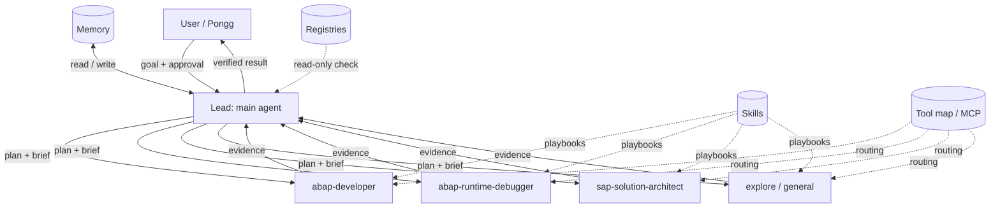
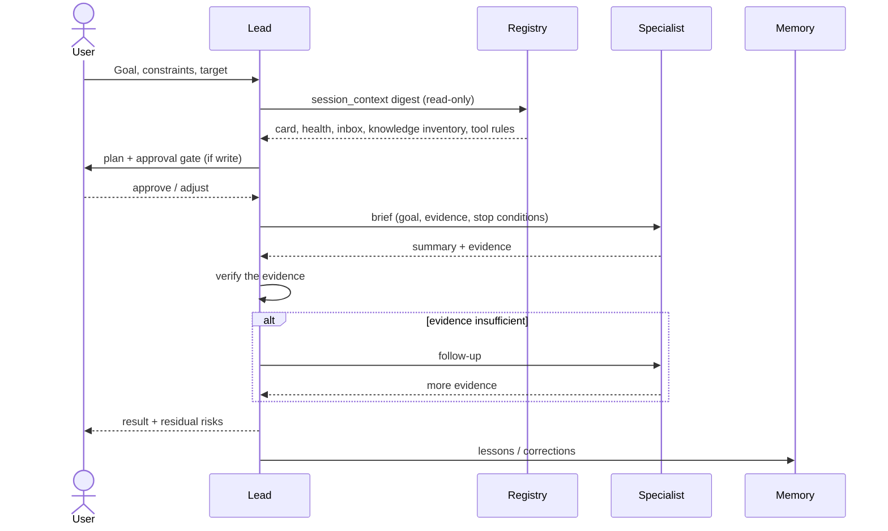

# ABAP AI OpenCode Toolkit

A small, portable AI teammate for ABAP work: a memory system, a registry scanner,
a spec and changelog contract, and the wiring that puts them inside your OpenCode
session.

The repository has **two layers**, and keeping them apart is the whole design:

| Layer | What it is | Where it lives |
|---|---|---|
| **Toolkit** | scripts, templates, docs, the tool-snapshot plugin, the SAP launcher | this repository, git-tracked |
| **Instance** | your memory cards, knowledge entries, specs mirror, registry report | `workspace/`, never committed here |

Clone the toolkit, run `install.ps1`, and the instance is yours. A colleague can do
the same without inheriting your notes.

It is harness-aware but not harness-locked: this repository is the **OpenCode** side.
Copilot keeps its own separate setup, so the two can be compared.

**Status:** v0.6 — instance separated from toolkit (`workspace/` plus the
`ABAP_WORKSPACE` override), a one-command installer, MIT licence. The memory model is
unchanged: incident -> inbox -> consolidation gate -> knowledge entry, with tiered
context loading and a live tool snapshot.
Last scan: 2026-11-15 · **issues: 0 · warnings: 4** (review items, none broken).

## Layout

```
abap-ai-opencode-toolkit\          # this repository
├── install.ps1                    # one command: instance, junction, plugin, AGENTS
├── scripts\                       # digest, closeout, registry and memory checks
├── templates\                     # spec, changelog, plan, probes, instance seed
├── plugins\tool-snapshot\         # OpenCode plugin that captures the tool catalog
├── config\opencode-sap\           # SAP launcher + Windows keychain helper (generic)
├── registries\                    # machine snapshots, regenerated per machine
└── workspace\                     # YOUR instance - git-ignored
    ├── memory\                    #   cards, knowledge, inbox, tool map
    └── specs\                     #   mirror of Projects\**\spec.md
```

`workspace\` is what `~\.config\opencode\memory` points at (a junction, created by
`install.ps1`). To keep the instance in its own private repository, clone it
elsewhere and set `ABAP_WORKSPACE` to that path; the toolkit never needs to know.

The toolkit was built for a portfolio that keeps SAP work in
`Projects\<PROJECT>\<PROGRAM>\` with an `INDEX.md` at the parent of the workspace.
Neither is required: `ABAP_PROJECTS_ROOT` and `ABAP_INDEX` point the checks at any
tree. New global folders go under the instance root; new SAP projects go under
`Projects\<PROJECT>\<PROGRAM>\` with an uppercase project code and the SAP object
name. Every project and program folder has `README.md`, `AGENTS.md`, and a small
manifest, and each project owns its own `_archive`/`_sandbox`.

Every program also carries `spec.md` - the contract we build and test against
(requirements, acceptance criteria, approved deviations, open questions) - and
`CHANGELOG.md`, one row per deploy covering the window before a TR is released.
The FS lives in `spec\source\`, is never edited, and is never committed. The spec
is written at the program level, because that is where a requirement is signed off;
the project keeps only `README.md` + `project.yaml` unless the project itself is the
deliverable. Templates: `templates/spec.md`, `templates/CHANGELOG.md`. Check:
`scripts\closeout.py`.

`Projects\` is not a git repository, so the specs are mirrored into the instance:

```
workspace\specs\<PROJECT>\<PROGRAM>\spec.md
workspace\specs\<PROJECT>\<PROGRAM>\CHANGELOG.md
workspace\specs\manifest.json            # version, status, sha256 per file
```

The customer FS is **not** mirrored - it is the customer's document, and this
repository must not carry customer data. The mirror is generated: edit the program
copy, then `python scripts\specs_sync.py --write`; `closeout.py` warns when it is
stale. Read the program copy, not the mirror.

**Access rule:** read/write inside the current project is allowed; read/write
outside it requires explicit user permission. Never recursively scan
`SAP Projects` or `<portfolio>`; use `INDEX.md` and the manifests.

## Team model

The main agent is the team lead. Specialists are subagents. The lead owns the
final answer and writes memory; specialists return evidence, not conclusions.



**Legend**

| Edge | Meaning |
|---|---|
| solid | work / handoff |
| dashed | reference / lookup |
| double | memory read/write (lead only) |

## Task lifecycle



The lead never forwards a subagent claim as a fact. Evidence is checked first.

## Approval gates

| Action | Gate |
|---|---|
| Read-only inspection | proceed |
| SAP write, activate, or transport | explicit approval with target + transport |
| Edit a personal `*-by-pongg` file | propose, then wait for approval |
| Edit a vendor agent or skill | never; wrap or fork into a personal file |
| Enable or disable an MCP server | propose, then wait for approval |

## Operating principles

1. **Evidence over guesses.** Unknown means "unknown" plus a read-only check.
2. **One owner per artifact.** Never parallel-write the same file or object.
3. **Read before write.** Re-read the live source; the local copy may be stale.
4. **Verify before claim.** Saved is not activated; activated is not tested.
5. **Ask before irreversible.** SAP writes, transports, and deletions.
6. **Vendor files are read-only.** Personal work lives in `*-by-pongg` files.
7. **Keep Copilot and OpenCode separate.** Different memory, different registries.

## Current registry snapshot

| Area | Count | Notes |
|---|---|---|
| Skills | 135 entries | opencode 30, agents 47, claude 30, copilot 28; vendor skills parked outside the catalog |
| Agents | 24 | 4 editable (`*-by-pongg`), 20 vendor |
| MCP servers | 16 | 8 enabled, 8 disabled; SAP, GUI, docs, Playwright are on-demand |
| Tools | 111 | 5 namespaces; measured 211 before the 2026-11-14 diet |

Prompt cost measured 2026-11-14: **36.0k chars per session** (skills 19.8k + tools
16.1k), down from 73.3k — both catalogs inside budget. See `docs/design.md`
§"Prompt budget". Parked skills and how to restore them:
`~\.config\opencode\skills-parked\RESTORE.md`.

The `sap-ai-dev-toolkit` 0.9.9924 update added 6 Copilot skills and 5 Copilot
agents (BTP, BW/DataSphere, Cloud ALM, DataSphere, process automation, DevOps
observability). They are vendor-owned and live in the Copilot registry only.

**Known warnings (not actionable):** 4 vendor skill descriptions exceed 1,000
characters — `abap-cloud-migration`, `badi-enhancement`,
`sap-integration-wiki`, `sap-support-case`. They are vendor-owned; forking is the
only way to shorten them. Everything else is clean.

`ai-dev-ds4-100` is an on-demand SAP server: it is enabled only during SAP work, and
`ai-dev-ds4-900` stays disabled. Both namespaces are marked optional in the tool
baseline, so turning them on or off does not create false drift.

## Install

```powershell
git clone https://github.com/<owner>/abap-ai-opencode-toolkit.git
cd abap-ai-opencode-toolkit
.\install.ps1 -DryRun      # show what it would do
.\install.ps1 -Seed        # instance, junction, plugin, AGENTS pointer, registry
```

Restart OpenCode once, then open a session and run the digest:

```powershell
python scripts\session_context.py
```

`install.ps1` is idempotent and touches nothing else: no SAP profiles, no
credentials, no MCP entries. Every file it rewrites gets a `.bak-` copy.

Requirements: Windows, PowerShell 5.1+, Python 3.8+. The scripts use only the
standard library.

## Quick use

```bash
# one call at session start: project card + health + open inbox + knowledge inventory
python scripts/session_context.py
python scripts/session_context.py --tiny    # light tier: ~0.8k chars

# then pick a tier: light (digest only) / task (+ card + the card's domains) / deep

python scripts/closeout.py                         # end of task: 4 rot checks
python scripts/registry_check.py --check           # full registry report + prompt budget
python scripts/registry_check.py --refresh         # merge new items
python scripts/memory_check.py                     # memory integrity, after close-out
```

`registry_check.py` also measures the **prompt budget**: the skill catalog and the
tool descriptions that the harness injects into every session, against the budgets
in `docs/design.md`.

Exit code `0` means nothing is broken; `1` means the report has an issue. Warnings
(new asset, stale date, over-budget description, idle on-demand SAP server) do not
fail the check — they need a human decision, not a fix.

The report is written to `workspace/memory/reports/registry-report.md`.

The tool snapshot is written automatically by `plugins/tool-snapshot` when
OpenCode loads and when the tool catalog changes. There is no manual snapshot
step; commit the updated `registries/tools-snapshot.json` and
`registries/tools-full.json` when they change.

## Compare Copilot vs OpenCode

The two harnesses stay separate: no shared memory, no shared registries. Run the
same task on both and record the scorecard in `docs/comparison.md`:

- correctness
- evidence (syntax / runtime)
- tool calls and turns
- safety (pre-flight, approval)
- context/token cost
- time to result

## Roadmap

- [x] Bootstrap memory snapshot and project card
- [x] `scripts/registry_check.py` — skills / MCP / tools drift report
- [x] `registries/*.json` — machine-readable snapshot
- [x] Session-start registry brief (global `AGENTS.md`)
- [x] Tool snapshot automation (OpenCode plugin `ctx.tool.list()`)
- [x] Tool-level drift (new/missing tool IDs)
- [x] Tiered context loading: `scripts/session_context.py` + `light/task/deep`
- [x] Issue vs warning split so a healthy session exits 0
- [ ] Skill and MCP onboarding gates
- [ ] Compare OpenCode vs Copilot on the same task
- [x] Instance separated from the toolkit (`workspace/`, `ABAP_WORKSPACE`)
- [x] One-command install (`install.ps1`, idempotent, `-DryRun`)
- [ ] `uninstall.ps1` and a non-Windows launcher
- [ ] Git history purged of customer data before the repository goes public

## Privacy and license

Toolkit: MIT (see `LICENSE`). Instance: yours — `workspace/` is git-ignored here, so
memory cards and mirrored specs never leave your machine through this repository.
No credentials, tokens, or customer data belong in the toolkit. See `SECURITY.md`.
