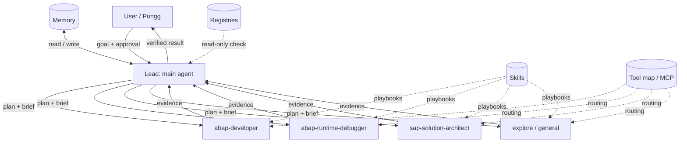
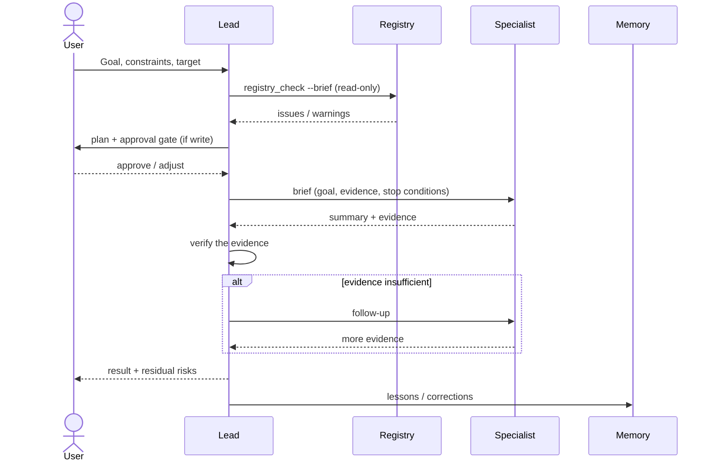

# ABAP Agent Workspace (OpenCode)

A portable workspace where the human and the AI grow together.

This repository is the backup and the operating manual for a small AI teammate:

- a **user profile** that teaches the AI how you work
- durable **lessons** and **corrections**
- **agent / skill / MCP registries**
- **project resume cards**
- a **read-only scanner** that reports drift

It is harness-aware but not harness-locked: this repository is the **OpenCode**
side. Copilot keeps its own separate setup, so the two can be compared.

**Status:** v0.3 — memory, registries, the registry scanner, and the live tool
snapshot plugin.
Last scan: 2026-11-13 · **issues: 0 · warnings: 4**.

## Workspace layout

The portfolio root is `<portfolio>`; the SAP workspace is
`SAP Projects`:

```
<portfolio>\
├── INDEX.md                        # small, shared read-only
├── AGENTS.md                       # portfolio rules
└── SAP Projects\
    ├── AGENTS.md                   # SAP workspace rules
    ├── abap-agent-workspace-opencode\   # this repository
    └── Projects\
        └── DEMO\
            ├── AGENTS.md
            ├── project.yaml
            ├── _archive\           # this project's archive
            ├── _sandbox\           # this project's experiments
            └── ZDEMO01\
                ├── AGENTS.md
                ├── program.yaml
                └── ...             # SAP program work
```

New global folders go under the portfolio or workspace root as appropriate. New
SAP projects go under `Projects\<PROJECT>\<PROGRAM>\`, with an uppercase project
code and the SAP object name. Every project and program folder has
`README.md`, `AGENTS.md`, and a small manifest. Each project owns its own
`_archive`/`_sandbox`.

**Access rule:** read/write inside the current project is allowed; read/write
outside it requires explicit user permission. Never recursively scan
`SAP Projects` or `<portfolio>`; use `INDEX.md` and the manifests.

## Team model

The main agent is the team lead. Specialists are subagents. The lead owns the
final answer and writes memory; specialists return evidence, not conclusions.



**Legend**

| Edge | Meaning |
|---|---|
| solid | work / handoff |
| dashed | reference / lookup |
| double | memory read/write (lead only) |

## Task lifecycle



The lead never forwards a subagent claim as a fact. Evidence is checked first.

## Approval gates

| Action | Gate |
|---|---|
| Read-only inspection | proceed |
| SAP write, activate, or transport | explicit approval with target + transport |
| Edit a personal `*-by-pongg` file | propose, then wait for approval |
| Edit a vendor agent or skill | never; wrap or fork into a personal file |
| Enable or disable an MCP server | propose, then wait for approval |

## Operating principles

1. **Evidence over guesses.** Unknown means "unknown" plus a read-only check.
2. **One owner per artifact.** Never parallel-write the same file or object.
3. **Read before write.** Re-read the live source; the local copy may be stale.
4. **Verify before claim.** Saved is not activated; activated is not tested.
5. **Ask before irreversible.** SAP writes, transports, and deletions.
6. **Vendor files are read-only.** Personal work lives in `*-by-pongg` files.
7. **Keep Copilot and OpenCode separate.** Different memory, different registries.

## Layout

```
README.md
AGENTS.md                 # workspace rules for any agent opened here
SECURITY.md
.gitattributes
CHANGELOG.md
memory/
  README.md               # how the memory system works
  user-profile.md         # how the user communicates and decides
  lessons.md              # durable lessons (date | what | evidence | target)
  corrections.md          # what the AI got wrong and how it was fixed
  skill-candidates.md     # patterns that may become skills
  agent-registry.md       # who owns which agent (editable vs vendor)
  tool-map.md             # task -> authoritative tool -> fallback
  team-roster.md          # subagent roles and delegation rules
  projects/
    README.md             # project-card template
    DEMO/
      zmme011.md          # project resume card
  reports/
    registry-report.md    # generated by the scanner
registries/
  README.md
  agents.json             # agent inventory
  skills.json             # skill inventory
  mcp-servers.json        # configured MCP servers
  tools.json              # tool-catalog baseline (ids + namespaces)
  tools-snapshot.json     # latest captured snapshot
  tools-full.json         # latest full tool list (id, name, namespace)
plugins/
  tool-snapshot/          # OpenCode server plugin; writes the tool snapshot
scripts/
  README.md
  registry_check.py       # read-only scanner
templates/
  AGENTS.md               # pointer block for a new machine
docs/
  design.md               # why the teammate works this way
  lifecycle.md            # onboarding / offboarding agents, skills, MCP
  comparison.md           # Copilot vs OpenCode scorecard
```

## Current registry snapshot

| Area | Count | Notes |
|---|---|---|
| Skills | 179 entries | opencode 78, agents 47, copilot 24, claude 30; cross-harness duplicates are expected |
| Agents | 23 | 4 editable (`*-by-pongg`), 19 vendor |
| MCP servers | 15 | 13 enabled, 2 disabled |
| Tools | 286 | 10 namespaces; written by the plugin |

The `sap-ai-dev-toolkit` 0.9.9924 update added 6 Copilot skills and 5 Copilot
agents (BTP, BW/DataSphere, Cloud ALM, DataSphere, process automation, DevOps
observability). They are vendor-owned and live in the Copilot registry only.

**Known warnings (not actionable):** 4 vendor skill descriptions exceed 1,000
characters — `abap-cloud-migration`, `badi-enhancement`,
`sap-integration-wiki`, `sap-support-case`. They are vendor-owned; forking is the
only way to shorten them.

`ds4-100` is an on-demand SAP server: it is enabled only during SAP work, and
`ds4-900` stays disabled. Both namespaces are marked optional in the tool
baseline, so turning them on or off does not create false drift.

## Quick start on a new machine

1. Clone this repository.
2. Copy `memory/` to `~/.config/opencode/memory/` (or point the global
   `AGENTS.md` at this repository).
3. Add the pointer block from `templates/AGENTS.md` to the global `AGENTS.md`.
4. Run `python scripts/registry_check.py --init` once, then `--check`.

## Quick use

Requires Python 3.8+; the scanner uses only the standard library.

```bash
python scripts/registry_check.py --check --brief   # session-start summary
python scripts/registry_check.py --check           # full report
python scripts/registry_check.py --refresh         # merge new items
```

Exit code `0` means no actionable issues; `1` means the report has issues. Warnings
(vendor description length) do not fail the check.

The report is written to `memory/reports/registry-report.md`.

The tool snapshot is written automatically by `plugins/tool-snapshot` when
OpenCode loads and when the tool catalog changes. There is no manual snapshot
step; commit the updated `registries/tools-snapshot.json` and
`registries/tools-full.json` when they change.

## Compare Copilot vs OpenCode

The two harnesses stay separate: no shared memory, no shared registries. Run the
same task on both and record the scorecard in `docs/comparison.md`:

- correctness
- evidence (syntax / runtime)
- tool calls and turns
- safety (pre-flight, approval)
- context/token cost
- time to result

## Roadmap

- [x] Bootstrap memory snapshot and project card
- [x] `scripts/registry_check.py` — skills / MCP / tools drift report
- [x] `registries/*.json` — machine-readable snapshot
- [x] Session-start registry brief (global `AGENTS.md`)
- [x] Tool snapshot automation (OpenCode plugin `ctx.tool.list()`)
- [x] Tool-level drift (new/missing tool IDs)
- [ ] Skill and MCP onboarding gates
- [ ] Compare OpenCode vs Copilot on the same task

## Privacy and license

Private repository. No credentials, tokens, or customer data. See `SECURITY.md`.

License: private, all rights reserved.
